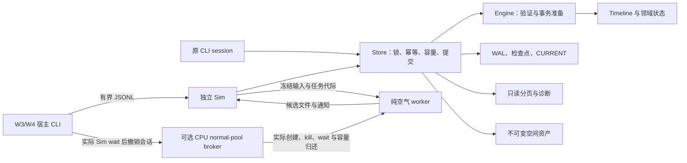
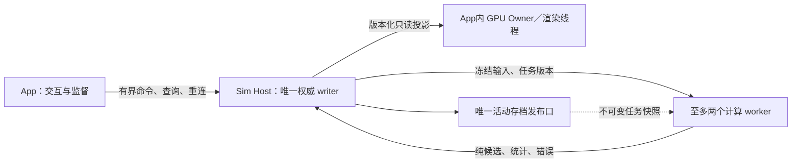

# MyCity软件总体架构

架构汇总S57；初版v0.5.22，现按W1—W4及T13-A的实际实现更新。历史冻结证据仍归其原发布版本。本篇总结软件如何运行，不再按建筑或游戏功能列策划清单。[完整产品蓝图](PRODUCT_BLUEPRINT.md)说明产品目标，本篇说明模块、状态、事件、进程、提交、恢复及资源归属；细节继承[A55部署契约](process-worker-and-render-architecture.md)和各运行专题。

标记约定：**已实现**是当前代码存在，**已实测**仅指相应冻结证据的有限范围；**设计**不是已经具备的能力。当前已有单个纯空气worker、独立Sim Host、有界宿主协议及Store接纳／恢复；通用worker池、完整市民／建筑系统、UI、AgentKit和渲染仍未实现。W1—W3各有冻结运行证据；W4正式联合工件、限制和独立结论按[联合运行专题](background-joint-runtime.md)单列，不转用旧测试或文档作通过。实际16GB与全城性能仍未验。

T13-A的当前构造边界见[固定词法容量阶段](evidence/m0-t13a-fixed-lexical/STATUS.md)：Store实际消费core双root／prepare、空间及Meta工作区；v1／genesis／v2收据正文使用Meta保留1MiB bit栈和借用span，区分忽略与Content校验。固定解析不等于整个冷开零分配；当前broker仍只授予既有IO／worker包，完整角色控制暂态及其授权仍在[NEXT](evidence/m0-t13a-fixed-lexical/NEXT.md)，不能据组件构造证明normal64或共享诊断预算已通过。

**v209已实现的共同请求边界：**`DescribeTaskExecution`只描述原Directory当前选择，`RunBoundTask`绑定版本化类型编码、scope/完整来源/sequence/Progress/Continuation/实例和原策略，执行前重算原路由，仍经原handler与Store/原Air接纳提交。预先披露原operation/Job用于不确定回复恢复，过期拒绝不能代替幂等查询。资源/细化/GPU当前明确unsupported/未解；传输8MiB、业务asset2MiB、control64KiB与授权分别表达，无第二writer/授额/退休权。40父测试及3冷进程的有限证据见[状态](evidence/task-execution-protocol-20261026/STATUS.md)，完整102/103/104未验收。

## 1. 一句话结构与当前部署

一个权威模拟核心拥有城市状态与排程，通过一个持久化提交口修改世界；工具、未来App、Agent和渲染通过命令／只读投影使用它，计算worker只产生可拒绝、可重算的候选。

**当前有两条实际入口**：原CLI session可在进程内调用Store→Engine；W3／W4宿主则启动独立Sim进程，Sim持有唯一Store writer。未启用normal pool时沿用Sim直接拥有worker Child；启用时由normal-pool broker实际拥有worker Child，Sim仅持租约和数据连接，宿主持Sim Child及独立监督凭证。两条路径复用相同核心和持久规则，不允许同时写同一世界。W1纯worker支持连续任务复用；当前Sim集成为每次attempt建立有界worker，尚未实现通用池或双worker并行。

| 当前crate／代码入口 | 责任 | 不能拥有的责任 |
|---|---|---|
| [city-core](../crates/city-core/src/lib.rs) | 单位、handle／arena、期初来源装配、领域状态、事务、日历、Timeline | 文件持久性、网络、窗口、GPU提交 |
| [Engine](../crates/city-core/src/transaction.rs) | 权限／scope／revision／操作ID；准备有限账本变更；调用持久hook成功后应用 | 自称仅内存执行已可靠落盘；让领域适配器绕过事务付款 |
| [Timeline](../crates/city-core/src/timeline_driver.rs) | 当前真实来源发现、边界、P0—P5、稳定同刻顺序、持久进度 | 所有未来产业／司法／交通已经完成；worker自行ack阶段 |
| [city-map](../crates/city-map/src/lib.rs) | CPU权威地形／几何、厘米及宽整数精判、灰度导入与候选布局 | 根据渲染近似坐标直接修改产权／交通权威数据 |
| [city-storage](../crates/city-storage/src/lib.rs) | 独占writer、WAL／根／检查点／原票、外部来源、容量和空间依赖恢复 | 第二套经济规则；多个进程同时写活动存档 |
| [city-headless](../crates/city-headless/src/main.rs)／[session](../crates/city-headless/src/session.rs) | 可信宿主Caller、暂停／单步、实验装配与诊断、有限CLI观察 | JSON自授System、普通命令随意set_property、用展示或计数代替执行 |

crate依赖是core；map→core；storage→core＋map；headless→三者。未来sim／tools／render／app／team-adapter是职责边界，不要求现在凭空拆空crate，也不能把相同权威规则再写一遍。core和map无需依赖App或AgentKit。

### 当前CPU broker的所有权与恢复

[CPU broker契约与验证计划](evidence/m0-t13a-broker/PLAN.md)区分物理进程和逻辑租约。宿主Client在内存生成监督凭证，注册／绑定实际Sim Child；只把不同的会话凭证传给Sim，不把监督凭证写ready文件或传入Sim环境。broker用实际Child拥有worker，Sim经短路径Unix socket直接交换原控制帧；broker不转发大payload，也不保留worker数据fd副本。worker仍只产生文件hash候选，Store、钱物与权利只有Sim可提交。

正常worker停止和故障撤销都走broker的实际wait→补回4MiB实体页。Sim被杀后必须先由其宿主持Child确认退出，再撤销对应代次；收到撤销回执并确认后才允许新会话。旧代次／旧租约的重复请求不增加信用，重复确认也不把旧事件记到新会话。Start回复丢失会busy，需旧Sim退出／撤销后重开，不能称Start原地重试成功。broker自身被SIGKILL则失败关闭，没有实际wait或正常归还报告，不自动接管旧ready或凭PID补信用。

这仍只有一个会话和一个空气worker；不是通用双worker池，不按主体开进程，也不是GPU Broker。真实有限进程故障见[当前来源工件审计](evidence/m0-t13a-broker/fault-audit.json)，完整满级业务和8小时须各按同源运行证据签收。旧W1—W4记录继续说明其原版本，不作为新来源联合／长跑通过。

## 2. 主体有状态、待办和历史，但只有一份权威

主体是业务身份，不是运行线程或独立进程：企业、家庭、建筑、运营设施、政府、共享设施等可以关联同一合同／事件。当前实际记录主要是账户、库存、区域、实验设施／交易及劳动汇总；Root Component／通用能力组件和全类型建筑仍是产品设计，不能把它们说成已有通用ECS或Actor运行时。

| 信息 | 权威及组织方式 | 例子 |
|---|---|---|
| 当前状态 | 有类型的领域记录，维护不变量和资源／财产权属 | 账户余额／保护款、库存成本、合同未偿、在途货物、工程进度 |
| incoming／待办 | 合同、作业、受信事实、到期／触发条件；索引形成主体视图 | 企业付款到期；家庭待收工资；设施维修计划 |
| 已发生历史 | 一份提交记录／领域事实，以主体与合同ID关联查询 | 同一笔工资同时出现在公司支出与家庭收入视图，不能付款两次 |
| 共享事件／关系 | 唯一ID、版本、参与方及资源／容量引用 | 两栋楼共享管线、承运交付、复合建筑共享通道 |
| 指标／展示 | 从已提交状态与有版本区间积分派生；必要时可重建 | 财政收支、污染暴露、满意度、动画中的抽样车辆 |

因此“每个主体都有历史与incoming events”作为查询和玩法理解是合适的；实现不应给每个动画人／房间／设备复制无限队列。历史与待办的通用主体索引、统一订阅、完整工程事项流仍未实现。现有receipts／timeline／arrears查询只是有限基础。

本项目采用**领域状态＋事务WAL＋检查点／原票**，不是已经完成“一切业务都可从无限通用event log重建”的纯事件溯源框架。事务回执、不可逆业务事实、未来计划和新闻叙事也不是同一种事件。原票用来查重与证明操作结果，不自动提供完整的企业经营史或居民人生史。

## 3. 命令、排程、事实与连续模型

一条命令表达意图；计划说明待办与条件；到期事件提出执行候选；通过权限、法律、容量、资源与资金检验后，事务才产生事实。城市指标由这些实际状态变化以及区间过程更新。游戏的建设、协商、司法等完整流程将落在领域状态机，不能用调度器跳过它们。

以工资为当前已实现的例子：劳动行在活动城实际工作区间累积分与余数→到达承诺账期→形成应付并按可用资金实付→家庭现金改变→不足部分保留债权→查询可见。共享一条支付结果，不给企业和家庭各复制一次付款事件。完整家庭消费和全行业工资税表尚未和这个Payroll联合。

连续劳动、交通汇总流、资源流、环境场等不必逐人逐秒排事件。使用有单位／余数的区间积分、固定批次及阈值触发；事件令相关投影失效或安排必要重算。未来动画读取约束下的采样，不能反过来以画面中车辆数作为真实通勤量。

### 当前T05-B与未来通用调度

当前Timeline从业务状态动态发现最近到期，最多跨一小时；同刻按P0应计、P1约束、P2权利／钱物、P3人口、P4观察、P5开工等已实现子集推进。权威进度保存phase／lane／cursor／serial及完整边界，来源和账一起持久化；完整规则见[T05-B](m0-timeline-runtime.md)。这不是每游戏小时把全部城市对象模拟一次。

未来计划可延期、取消、改约或重算，但需要版本及有效边界；已冻结阶段不能随意重排成“先收钱再偿债”的套利顺序。已付款／消耗／损失的事实不倒改历史，必须由新退款、冲正、赔偿或恢复事实处理。通用订阅、依赖失效、优先级、取消代际与任意任务动态改排仍需后续实现，不把当前固定领域适配器包装成通用任务平台。

区域采用一个单调交互钟和各城独立发展年龄；休眠城快照不生产资源，自主劳动／增长不补跑，已接受合同、在途、钱物和容量仍实际履约。[区域契约](regional-snapshots-and-interaction-ledger.md)是权威，不能为了调度方便恢复所有城共同本地日期的旧方案。

## 4. 唯一提交口与失败语义

正常操作路径为：可信宿主确定Caller→命令解析／尺寸限制→Store查热冷原票并验证身份及payload→来源frontier和容量准入→Engine验证并准备变更→WAL与根发布→应用同一内存结果→返回回执。前置拒绝、已记录的业务拒绝和I/O未知分别表达，不能一律当作“没有发生”。

| 情况 | 处理 |
|---|---|
| 同ID、同主体、同payload重试 | 返回原结果，不重付、不重迁、不再扣续做票 |
| 同ID换payload／换主体 | 冲突或越权，不当作新操作 |
| 资源／现金不足 | 原子拒绝或按领域规定部分履约并保留债务，不能创造资源 |
| 持久hook失败且未发布 | 不先应用内存半结果 |
| 发布可能已经发生、响应丢失／I/O未知 | 暂停并隐藏受污染writer状态；按CURRENT重开，再查原票 |
| 当前边界尚未排空 | 保留游标、真实中间态和必要预留，不让下一阶段越过 |

这里的“恰好一次”限定同操作身份在现有提交／恢复协议里的业务效果；不是声称任意网络、物理断电或所有外部系统具备分布式恰好一次保证。进程退出注入与真实断电、逻辑容量耗尽与物理磁盘故障分别验收。

T05-B先以正常容量购买单一安全边界的有限续做票，保护后续页的字节及回执槽；正常区耗尽仍可完成既有边界，远期目标不获得无限应急资格。纯阶段和零付款登记也是必要进度；无效请求不能挤占剩余槽。完整边界后再为下一段准入，不靠无限自动checkpoint或删历史维持运行。

## 5. 进程部署：已实现的有限链路与未来客户

下图中的Sim／单worker／文件及宿主IPC已有W3实现；App、双worker池、GPU及完整投影仍为设计：

Sim不是只转发任务的空壳：它拥有主体权威状态、时钟、排程、准入、权益、接纳及提交。App主要负责交互和监督；worker执行耗时纯计算，不能把付款、库存扣减、合同确认或phase acknowledge留给进程竞速决定。

未来通用worker池目标为常驻、有界、按块／批运行；当前W3／W4单worker按attempt创建，不应称作已完成池化。任务协议必须包含世界／分支／规则版本、输入hash／snapshot、job ID／generation、范围、scratch和输出限额、取消／超时／重试预算。结果接纳时核对输入版本、权限、输出尺寸与模型条件；过期或重复候选拒收，崩溃回收后可有限重算。不可重算的业务副作用只通过Sim提交，不因worker重试再次支付。

当任务候选被接纳并已提交，而worker或App没收到响应，恢复依靠原票／提交根；不能因为“再算一遍便宜”而再执行一次事实。暂时不可得到必要候选时，安全暂停或使用已验证的同策略CPU路径，不跨过依赖假装计算完成。

## 6. 数据文件与跨进程共享

| 数据 | 当前／目标 | 写入所有者 |
|---|---|---|
| Genesis、规则身份及期初来源 | 当前已保存并校验；重新打开不再注资 | Store创建，之后不可变 |
| WAL、CURRENT、检查点／冷原票档案 | 当前实现；同根恢复与精确重试 | 单一Store writer；W3入口由独立Sim持有 |
| 空间输入、灰度图及其hash／派生版本 | 当前不可变资产同根校验 | 创建后不可变；运行时地形修改另做正式事务 |
| worker输入／候选文件 | W1—W3已实现有界内容寻址文件及JSONL控制；完整只读投影另做 | Sim发布冻结输入；worker仅写隔离候选输出 |
| 渲染／工具／主体索引 | 当前有限分页，完整投影设计 | 权威事实由Sim发布，消费者只读或维护可重建缓存 |

共享文件是数据交换介质，不是多进程协作协议的替代。不能让worker各自Store::open后修改同一活动世界；现有独占锁就是要阻止第二writer。也不依赖消费者随时读取正在改写的WAL尾部获得一致视图，未来需按发布版本取得完整快照／lease，并限制旧版本保留、确认退休及崩溃回收。

内存映射／共享页并非当前已实现优化；可用时按allocation ID去重算实际物理页，私有副本各计。所有文件引用需校验长度、hash、规则与generation；候选错误不写回权威输入。旧源码／规则世界的迁移是显式兼容任务，不静默用新二进制继续旧语义。

## 7. CPU、GPU和展示边界

CPU拥有金额／余数、产权、法律、合同、容量、最终几何判定和提交；可并行的寻路批次／环境场等由已冻结策略产生候选。GPU候选必须和CPU参考比较，并接受陈旧输入、设备代际、回读和精度检验后才能被使用，不能让GPU浮点值直接决定货币权益。

渲染读取已提交快照，CPU厘米权威向GPU投影为块内f32及显式布局；wgpu承担后端兼容，当前不单做Metal／DX12适配。渲染线程／独立Render Host是部署选择，不是纯计算worker的一种支付权限。A55首选未来App内GPU Owner／渲染线程，独立Render Host需真实窗口、显示、同步、复制成本和恢复对照后另验；本轮没有GPU执行证据。

AgentKit未来是命令／查询的客户，不是城市writer：玩家意图经City Team形成有限授权请求，仍经过调查、协商、预算、法律程序及提交口。具体Agent集成与UI／语音继续延期，本篇没有实现或扩展它们。

## 8. 资源、确定性与观察

预算属于整个应用进程组，不能给每个worker／城市各领一份。现行全产品常态候选3.10GiB，真实16GB联合门未通过；运行时与求解、渲染、工具等域按[预算总表](product-runtime-budget-and-versions.md)共同准入。A55至多两个普通32MiB计算任务；预演模式减少并发／停GPU候选；进程基础开销、共享投影、IPC、保存高峰及重建副本都需计入，不能只报Engine owned。

T05-B当版小负载明确Timeline最多2MiB常驻、普通事务副本2MiB运行时份额及Engine4MiB owned门；这些旧门不自动覆盖T13-A满级输入。T13-A采用64MiB常规工作区候选与共同8MiB诊断候选，实体池的64MiB已触页余额及worker4MiB借还不等于所有Engine／serde分配都已纳入；未转换分配保留为额外压力，精确常规预算仍未签收。检查点保存／恢复规划仍归共同高峰额度，不因新增进程各领一份。规划不等于实际allocator硬门；当前宿主是M4／32GiB；W4单独记录完整进程组观察与采样限制，不能代替真实16GB、GPU／全城压缩与swap验证。

确定性要求相同规则、输入、已提交日志及数值策略在不同分页／恢复／worker返回顺序下得到相同精确权益。整数单位、有理余数、稳定来源ID及阶段顺序进入权威状态；随机不得按渲染帧或worker完成先后抽取。近似统计和GPU误差另列版本与容差，不能泛化成账款也允许“不精确”。

观察需标出snapshot／revision、last_complete与工作at、partial阶段、source frontier、欠费／资源阻断、容量及unknown状态；工具查询不推进时间或改账。当前已有有限status／分页／receipts；统一主体历史与事项进度、全部指标订阅和原生观察界面仍待实施。

## 9. 分阶段工程门与当前未完成项

| 阶段 | 范围 | 进入下一阶段前需要的证据 |
|---|---|---|
| T05-B基线v0.5.21 | 单进程Rust／CLI、有限领域事务、空间、经济／区域实验、Timeline与恢复 | [当版185项测试及独立复算](evidence/m0-t05b/verified-summary.json)，不扩为全产品完成 |
| S56本次汇总 | 当前结构与目标部署分开，主体／事件与数据所有权统一 | 文档引用、源码职责、预算和未实现标记一致；只验文档 |
| T12 CPU参考子阶段 | 选择一种有限场策略、真实输入、边界／精度、批次与保存重放 | 同策略可重复参考结果、失败／限额、增量预算实测；GPU仍延期 |
| P-WORKER | 单worker再双worker，纯任务协议和有界重算 | 与CPU参考一致；杀进程／过期／重复／超限／取消，实际总内存与时延 |
| P-SUPERVISOR | 独立Sim与宿主监督、有界IPC、唯一writer／重连 | App／Sim退出、原票重试、死worker回收、第二writer拒绝；不改领域语义 |
| 图形／Agent阶段 | 另获范围授权后实现只读快照客户 | 真Mac窗口／GPU／输入和工具权限实测，不能拿CLI／打包测试代替 |
| T13／T14完整M0 | 必要模型门及产品负载联合 | 真实16GB、长跑、保存／日志、物理失败边界与未达性能门如实列出 |

完整软件尚缺通用主体／事件索引和动态依赖、全城交通／环境求解器、更多产品领域、统一进程组准入、通用worker池及完整客户协议；已有有限多进程链路不替代这些能力。后续按真实模型依赖推进，不先把所有函数搬到进程里，也不把当前领域状态改写成逐人Actor系统。

本版[静态核对记录](evidence/software-architecture-s56/checks.json)及[复跑脚本](evidence/software-architecture-s56/verify.py)检查crate依赖、当前源指纹、文档责任及预算算术；它们不是worker／GPU／性能测试。v0.5.21的模型结果仍由原冻结证据负责。

v0.5.23执行更新：[T12-A](m0-air-cpu-reference.md)新增core.air纯数值任务与CLI工件恢复，模块／唯一writer职责不变；它不是独立计算worker或城市环境writer。上文v0.5.22静态证据保留其冻结版本含义，当前模型证据按新运行专题分别登记。

v0.5.26执行更新：[W1](background-worker-runtime.md)新增真实独立、可复用的空气worker和有界JSONL／候选文件交换，连续场及探针握手故障已进入本版运行验证。上文“设计／尚无共享API”描述的是v0.5.22基线；目前纯任务输入输出已实现，但世界持久ticket、独立Sim、P4屏障及全进程联合运行仍待W2—W4，不改变Sim唯一写入目标。

v0.5.27执行登记：[W2运行专题](background-store-runtime.md)接入实际货运输入、Core任务／P4屏障、Sim不可变候选资产与小WAL同根提交、预留和恢复。当前Sim职责仍在CLI中；独立Sim／监督、统一worker缓存及1800秒联合进程组验证仍须W3—W4实测，不能用阶段提交替代。

W3／W4执行更新：独立Sim、固定读集／代际、唯一接纳原票、OS缓存栅栏与分阶段恢复见[W3运行专题](background-sim-runtime.md)。七日有限经济／跨城／空气实验、实际进程故障、完整进程组观察和当前验收状态见[W4运行专题](background-joint-runtime.md)。以上已实现与历史“目标部署”分开，原S56静态核验器应在其冻结tag复跑，不假称当前源码仍是原指纹。

v0.5.49执行更新：[耐久控制器](evidence/m0-t13a-endurance-controller/STATUS.md)以单调时轴串行发布既有事务与独立计算故障，不将每个主体转换为独立进程。Engine.world盒装解决实测默认栈恢复溢出，线格式保持不变，堆成本仍计入；精确常规工作区和Rust联合监督仍待接入。主体权益逐笔保存与按事件稳定区间批处理可共存，快进不改变游戏时间因果，现冻结小时目标不变。

v0.5.50执行更新：[联合托管](evidence/m0-t13a-joint-endurance/STATUS.md)接入Rust supervisor真实Child和布局owner管道；合法停止与EOF分开，布局时轴覆盖业务退出后才允许收尾。CpuLog先持久发布有界身份首行，故障footer缺测保持缺测。原完整联合实测触发pressure保护，不能将接入代码写成完整联合运行通过或精确内存预算已闭合。

### #102 共用实际执行报告接线（v208有限接线已验证，完整102开放）

空气工作计数、等价页暂停/继续、页采样及单任务自动Continue已在v164–167实现并实测，不重复开发。当前root沿既有四provider目录补Sim内原Advance与Air worker的显式类型分支报告；不构造AirTicket，不增加调度器、进程或任务租约。Service/Supply/Timeline选中来源不同，同一原operation只记录一份执行。保留完整SourceBinding、可选原TaskKey、原Scope/sequence/Progress/operation与Advance目标/limit；同刻零窗不补造TaskKey或已处理区间。

采样只围住原cpu_log::execute，包括原持久化/诊断IO；同Sim全线程CPU与宿主elapsed分别报告，不称领域独占CPU或queue age。单位为实际提交Advance operation，不能和空气sources/cells/integration/pages相加或当成目标完成；原票重放计0次新提交，提交不确定保留未知。原结果拒绝/不确定与原票确认分别保留。计量失败或报告超界只令观察不可用，不能改业务结果、原责任或退额；物理分配失败仍沿原进程故障和恢复义务处理。

报告只保留每个执行位置最近一次，Sim退出后不从旧票补CPU；继承原Sim角色，不给内部任务重复授权或归还。scratch peak仍未知。新元数据规划64KiB、输出12KiB上界包含在原角色与诊断预算中，规划不是实测峰或新增授权；须经真实原角色联合验证。当前source04的28项限定检查通过，详见evidence/task-execution-report-20261026/STATUS.md；通用能力/细化/授予与成本接口尚缺，#102/#103/#104保持开放。

#102 v208 successor (unpublished/not_run): production observation uses the original process-clock and cpu_log::execute functions through a private dependency seam. Tests may supply an unavailable clock or the existing Store write-observer callback to execute real retained transactions under interruption; no product request/env fault switch exists. Unknown observation never changes the original outcome; CurrentRenamed uncertainty is not proof of no commit. The next shared request interface is bound to the original current selection, never arbitrary task/target selection or resource authority.
