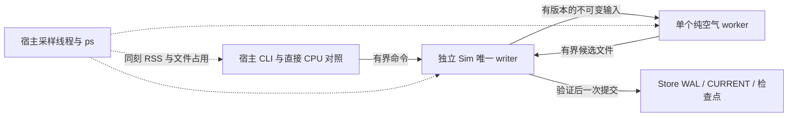

# W4：可恢复后台计算联合运行

当前状态：冻结源码下完整Release测试232项、fmt和Clippy通过；正式1800秒实验、归档核验和最终advisor独立审查均通过；本次交付v0.5.29，实际Git发布以远端为权威。目标／停止条件继承[W0冻结验收](background-compute-acceptance.md)，输入与工作量见[联合实验计划](background-joint-experiment-plan.md)。此页不以快跑签收持续运行。

## 1. 实际架构与权威

宿主CLI负责发命令、监督和观测；独立Sim拥有唯一Store锁、城市状态、Timeline、准入和提交；空气worker只读冻结输入、分页计算并发布可拒绝候选。直接CPU对照在宿主内运行，不读取worker候选。采样线程同属宿主，外部ps进程也计入观察。



当前只支持一在途任务、一worker、每job最多三attempt；W1纯worker可连续处理任务，但W3／W4集成按attempt创建进程，尚非通用池或全主体Actor系统。宿主断连不会授权Sim自由推进新日历。共享文件是版本化数据交换介质，只有Sim持有Store写权限；worker目录不是权威存档。

空气输入来自实际货运区间／空间锚点。P0冻结读集，P4前必须完成必要候选，P5不得越过。已经提交的工资、税款、货款和消耗不因worker失败回滚。Sim再次用同CPU路径检查完整候选是正确性开销，不是加速证明；EI实验参数不是现实尾气质量或健康证据。

## 2. 业务闭环与对照

冻结输入为[期初](../fixtures/m0-background-joint-opening.json)与[策略](../fixtures/m0-background-joint-policy.json)。七日含两次真实货运、泵和机组启动、日／周劳动、每日固定额营业税、合同到期和有资金来源的零息借款。城1在第2日至第3日休眠，不补跑其自主劳动；已接受区域责任按交互钟运行。

`Timeline::Lend`是一次有类型原子操作：借出方实际转出本金，同时创建Claims债权。它复用既有额度和持久hook；不足资金、hook失败无半放款／半债权，同ID重试只得原票。不是通用银行、利率市场或无来源财政收入。

每个检查点比较完整World、resources、leases、next_token和完整Timeline，仅归零world.revision，排除journal与后台管理元数据；完整空气State另比。World包含Inbox，故共享容量泄漏、收件责任及非余额字段不能被摘要遗漏。资源容量变化但WorldView未变的反例已进入测试。

独立事实校验不只比较同实现的两条路径：逐项核对实际库存、泵／机组完成和燃料费用、货运交付及运费、税到期／实收／欠款、工资、合同债与未来借款。收件费用实际结清并归档；借入本金仍为负债，非营业收入。有限规则不包含完整利润税、工资扣缴、生产消费全行业或经济平衡验证。

## 3. 故障与重开

- worker在Cells分页中途实际SIGKILL；Sim保留必要job，持久换代后重新算，最终候选与直接CPU一致。
- 另一个job在已发生首日工资和税款后，Sim于根提交但尚未回复时实际SIGKILL；全新监督客户端重开，查询固定接纳ID取得原票，不重复业务支付。
- 每日检查点；第七日结束后再次检查点、查冷原票、正常停止并新进程重开，完整业务／空气不变且最终回执仍为原记录。

此前W1—W3包含更多阶段故障、坏输入／旧代际、三次封顶和存储容量反例，详见各自冻结证据；本次联合并不声称把所有物理断电或硬盘失效情形重做一遍。异常恢复不能依靠旧客户端析构先杀孤儿；worker身份登记与OS缓存栅栏负责跨Sim回收／隔离。

## 4. 运行、核验与资源限制

在匹配冻结源码的tag上：

```sh
cargo build -p mycity-headless --release --locked --offline
target/release/mycity-headless joint-probe /tmp/mycity-joint-new-run 1800
python3 docs/evidence/background-joint-w4/verify.py --run /tmp/mycity-joint-new-run
```

目录必须不存在。最后一条仅在真实运行成功后验证；0秒快跑须显式`--dry`，永不通过耐久门。源码、fixture、策略及可执行文件摘要记录在启动工件；运行期间冻结源码。日志／采样／全部检查点及CPU参考保留为可核验工件，核验器拒绝错源码、缺档和时长不足。

小时目标均匀分布于实际1800秒，不先跑完再空等；170个检查点包含启动60／120秒及168小时。采样从子进程启动前到停止后，间隔目标250ms，有界ps输入、64MiB／12000行采样和32MiB命令日志。持久缓存charge与实际文件占用分别报告；磁盘数是采样所见逻辑文件字节，非严格峰值或分配块大小。

每帧RSS取同一次ps的宿主、Sim、worker、采样ps及已知孤儿之和，报告实际最大采样间隔与未采到的已声明PID。共享页可能重复，短于间隔的进程／峰值可能遗漏，出生身份为秒级lstart；因此这是观察峰值，不是去重物理内存或严格瞬时峰值。队列容量4帧／64KiB、一在途、三attempt已限制，但实际队列峰值占用未插桩，不能虚报测得为1。

宿主实际为M4／32GiB，记录前后系统内存、vm_stat和swap；这些是整机背景状态，不能全部归因本实验。16GB门维持not_run；全城、8小时、GPU／UI／AgentKit、物理断电、跨平台和完整M0均未签收。正式工件和核验结果见下一节；原始report的`final_advisor_review=pending`是进程退出时的事实，后续结论另存，不篡改原运行报告。


## 5. 正式运行结果（2026-10-20）

源码指纹`829b88384cd243bdb66f4c4c9deff59c764067412d5dc2c856bef21149cf7417`；UTC 06:45:38启动、07:15:39正常退出0。工作推进实际1800.435030958秒，整个命令1801.217039秒。不是快跑后补等待；170个检查点的原始时间与小时目标逐项核对。

| 实际结果 | 观察／核验 |
|---|---|
| 游戏时间／场窗口 | 七日604800秒，173个必要空气窗口，170点完整业务／空气均与宿主直接CPU一致 |
| 真实故障 | job2 Cells中途SIGKILL worker后换代；job29首日业务已提交后SIGKILL Sim且未收到接纳回复，全新客户端取原票 |
| 钱物守恒 | 总现金3000000分；末现金财政2400000、公司2为196950、公司3为47636、供应方354550、家庭336／528；保护款归零 |
| 工资税债 | 两劳动各172800秒＝48小时；日／周工资336／528分均已付；固定税应计＝实收1400000，曾欠201612后有来源借款清偿；原合同1000已付，850000借款第10日才到期未付 |
| 实际履约 | 两货运各交付1000mQ、货款2000分／运费20分；泵和机组各完成一次、燃料1000／费用500；水电和废物库存保留；资源占用／预留全释放；收件费应计＝实付10、closed2无悬空责任 |
| 持久恢复 | 8份哈希链检查点、712份原回执；最终冷重开完整业务／空气不变，最后任务仍返回相同原票 |
| 同刻资源观察 | 6419帧，RSS和观察峰49823744B＝47.515625MiB，峰时包含宿主／Sim／worker／采样ps；最大同时组大小7（含短暂辅助／恢复进程），不是每个角色单独峰值相加 |
| 采样限制 | 目标250ms，实际最大间隔0.417930666秒；两短命worker PID31138／38319未采到；共享页重复及间隔内峰值遗漏仍可能存在 |
| 文件与时延 | 观察世界文件峰31403698B、含日志与参考的实验目录峰41562636B；最大必要任务往返1.169667583秒；命令日志5759286B、采样4431903B，均在预设上限内 |
| 进程收尾 | 最终采样仅宿主及其采样ps，无剩余Sim／worker／已知孤儿；随后宿主正常退出，原PID已不存在 |

最终存档worker缓存持久charge6291456B，实际缓存1377716B；charge不因删文件退款，实际文件与预算分别记录。这里的文件峰值是采样所见逻辑字节，既不等于严格磁盘瞬时峰值，也不等于RSS。实验目录后来归档压缩为709601B，不能拿压缩大小代替内存。

[原始报告](evidence/background-joint-w4/probe.json)、[启动／退出记录](evidence/background-joint-w4/launch.json)、[工件manifest](evidence/background-joint-w4/artifact-manifest.json)、[完整压缩工件](evidence/background-joint-w4/run.zip)、[独立核验结果](evidence/background-joint-w4/checks.json)和[核验器](evidence/background-joint-w4/verify.py)一起保存。归档内有原始命令事件、采样、完整Store及CPU参考；默认核验命令为`python3 docs/evidence/background-joint-w4/verify.py`。重新真实运行用第4节新目录命令，不把重读工件称为重新跑了1800秒。

[逐项完成审计](background-compute-completion-audit.md)覆盖原目标；[架构前审](evidence/background-joint-w4/advisor-architecture-review.md)不替代最终联合审查。实际32GiB的有限小样本不证明16GB门，也不证明完整M0、经济均衡、全城、8小时、真实污染或通用池吞吐。

最终[advisor联合审查](evidence/background-joint-w4/advisor-final-review.md)读取原始工件并独立核验，未发现阻断，同意本次有限闭环收口；没有另跑一次1800秒，也没有替代真实16GB测试。
