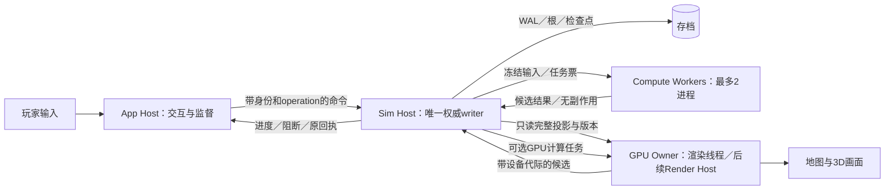

# 进程、计算worker与GPU渲染架构

设计A55，发布v0.5.20，2026-10-20。用户提出“任务交独立worker，出错可重算；主App负责调度，3D渲染是否也可独立”后补充。本篇是总体运行架构决策与待验证原型计划，**完整目标拓扑不等于已实现通用进程池、窗口或GPU渲染；不凭本设计签收T11、P-GPU或16GB**。此句取代v0.5.20时“IPC尚未实现”的历史现状；当前有界Sim／worker IPC及可选CPU broker的实际边界见[软件总体架构](SOFTWARE_ARCHITECTURE.md)。现有CPU／GPU职责继承[计算契约](cpu-gpu-compute-contract.md)，城市、经济与跨图规则不变。

## 1. 先确定职责，再选择线程或进程

“主App负责调度”拆成两种不同权限：App调度交互、任务请求与进程生命周期；Sim调度有因果顺序的城市事实并独占提交。App可请求暂停／倍率／目标，但不自行宣布时间或建设已完成。渲染可以独立线程或独立进程；GPU本来异步执行命令，异步GPU任务、CPU线程和OS进程不能混作同一概念。

| 模块 | 负责 | 可重建／重算部分 | 权威及生命周期 |
|---|---|---|---|
| App Host | 窗口、输入／未来文本语音入口、观察、监督、任务与连接状态 | 只读投影、交互缓存、连接 | 不持Store写权；原生窗口事件遵守平台线程要求 |
| Sim Host | 全存档唯一writer、领域时钟／P0—P5、接纳规则、钱物／权利／容量／持久游标 | 到期索引和派生缓存 | 独立进程目标；从当前确定持久根恢复，不能靠重跑付款恢复 |
| Compute Worker池 | 寻路候选、批量需求匹配、环境场CPU参考、地形／网格加工、受限预演的纯计算 | 版本化输入上的结果 | 首个进程池候选最多2进程，每进程1在途任务；无Store写权 |
| GPU Owner／Broker | 渲染资源、Device／Queue／Surface、有限compute候选、完成／失效通知 | GPU缓冲／pipeline／画面 | 首个图形原型候选在App专用线程；窗口／Surface生命周期仍由合法宿主协调 |
| Render Host候选 | 进程隔离的离屏渲染或场景窗口 | 完整图形投影与资源 | 必须另做原型；通过后迁移GPU Owner，不能同时再启动一套完整资源 |

早期headless CLI与Store同进程入口仍保留；当前独立Sim及单空气worker另有实际实现，启用normal pool时broker持实际worker Child、宿主在实际Sim wait后撤销会话。上图仍是完整目标拓扑，当前单worker托管不能扩为通用进程池／渲染已实现。CLI未来可替代App作为受信宿主。单文件世界内不按每个城市启动一个Sim，不按格子／建筑／居民启动worker；批量和聚合模型继续适用。模拟一个世界的多个来源可并行算候选，权威提交仍按确定的阶段／子序。

## 2. 哪些适合worker

| 工作 | 位置与调度 | 失败后的处理 |
|---|---|---|
| 路网批次、OD分配、污染／噪声场、需求匹配 | Compute池；GPU适合的场／批次经GPU Broker | 保留同版本输入，重算同一批，校验覆盖／精度；不能用抽样少算代替完成 |
| 地形解码、几何细分、网格／LOD构造 | 受限worker，输入只读资产块 | 候选未验证不发布；坏资产确定失败不无限重试 |
| 保存压缩／只读查询索引 | 可外包冻结页计算 | Sim管理固定输入代际、写入边界与最终根；worker不持写锁或自行轮转WAL |
| 现金／库存／税工资债／租约变更、游标推进 | Sim权威事务 | IO不确定时查根和原票；不能作为普通纯任务再次扣款 |
| 源事实接纳、付款回执、外部确认 | Sim／受信来源可靠收件协议 | 保留pending和原operation，先确认持久边界再确认来源 |
| 窗口创建／销毁、输入焦点、全屏、Surface绑定 | 合法窗口宿主与GPU Owner协作 | 重建表现，重连已提交模型；由原生图形门验收 |
| 相机、可见性、动画、渲染编码／GPU执行 | 渲染模块；可并行CPU加工，统一GPU资源归属 | 旧帧可跳过／重画，模型事实不随掉帧丢弃 |

“都外包”可以作为逻辑接口风格，但不要求每次小计算都经过IPC。小型整数校验和提交留在Sim；worker以批为单位复用进程。物理守恒／合法性不能只靠候选总数自证，Sim必须进行可负担的结构、范围、容量、守恒和权限校验。worker隔离是故障隔离，不代替正确性或安全验证。

## 3. 任务票与IPC数据契约

本节是待实现协议，不新增当前命令权限。IPC首选本机有界控制通道，首个实现可用分帧字节协议；大页可引用内容寻址只读文件，再考虑共享映射。不得序列化Rust指针、typed handle的内存地址或wgpu对象。共享内存也必须有长度、范围、版本、只读／写入所有权和租约，不能让worker改Sim的权威页。

任务票至少携带：

| 字段组 | 必需含义 |
|---|---|
| 协议／输入 | schema、rules/source/algorithm hash、world／branch、完整快照revision及hash、读集版本（首版可严格整快照）、输入分块hash／长度／布局版本 |
| 因果位置 | interaction时点、local city/time适用范围、目标T、phase／subphase、owner与generation、occurrence、稳定分页范围及完整覆盖要求 |
| 任务身份 | job_id、writer incarnation、job_generation、attempt、设备代际（GPU任务）、宿主分配的能力类型 |
| 确定性 | 固定seed／随机域、积分余数、固定数值策略及归约顺序／容差资格；重试不重新抽样、不读取新网络数据 |
| 准入 | 输入／输出／scratch字节上界、时间预算、CPU并发、取消代际、必需或可选、已预留恢复页额度 |

控制帧规划≤64KiB，逻辑队列≤32任务、描述符不超过1MiB；输入／输出块受第7节额度限制，超长、坏校验、错scope、错schema不反序列化成可信命令。外部地图／模型数据永远不提供Caller。工具operation和计算job是不同身份：同一个业务operation可有多次attempt，但不能由attempt生成新的付款ID。

首个结果验证采用严格输入版本；因此本期必要计算期间Sim停在对应因果屏障，不同时推进会使该输入失效的阶段。未来细读集可减少无关revision导致的废算，但必须先定义读集冲突规则再放宽。渲染是观察，可以显示有年龄的旧完整投影；建设批准、支付和实际容量不能拿旧结果当当前事实。

## 4. 任务状态、崩溃与一次提交

逻辑流程为 `Accepted → Running → ResultReady → Validated → Committed`；Cancelled／Superseded／Failed是独立终态。工作进程消息不是状态权威，Sim保存必要任务意图、输入绑定、阶段屏障、接纳代际及提交原票；可选派生缓存不需要全部进WAL。协议至少允许消息丢失、乱序、重复、worker完成后死掉和writer重启。

1. Sim在接纳必要计算前预留输入可复现性、结果工作页与最低恢复资源，持久记录所属阶段；未持久接纳不向玩家承诺办理完成。
2. worker读不可变页、计算并交付带hash／范围的候选，不付款、不释放权威租约、不向外部来源发“已处理”。
3. Sim先检查身份、代际、快照、输入、算法、覆盖及领域约束。陈旧候选拒收；部分页只更新处理中进度，最后必要页完成前不发布完整时点。
4. 领域变化、任务消费／结果接纳标记与持久游标在同一事务提交。重复结果和重试只能取回相同原回执；“计算完成”“已持久接纳”“已产生城市效果”分别显示。
5. writer在提交后、发响应前退出：恢复查原operation，不重做副作用。writer在提交前退出：从同一输入重算。找不到任务状态只能说unknown，不能让App猜测新ID重发。

瞬态故障规划最多3个自动attempt；超时先取消该attempt并递增代际，再决定终止进程。重复确定性失败、输入校验失败、OOM或资源不足不能无限拉起进程。必要任务保留义务并阻塞依赖阶段；有验证过且同策略的CPU回退才启用回退，否则安全暂停。可选统计／预演／画面可取消并说明缺失，不牵连钱物正确性。

已取消任务仍可能晚到，只有当前代际能接纳；worker重启、Sim重启或切世界／分支均更新相应代际。切到另一活动城不自动废掉全存档必要履约，依读集／时钟范围判断；App的显示切图与Sim的活动城变更必须是不同操作。来源快照仍不变成资源，不恢复已淘汰的全城共同发展钟。

必要计算期间必须仍有一条受限责任处理通道：已收到债务的合法移交、已付清记录归档、收件去重与来源确认可在声明不改变冻结资源的范围内进行。改钱、改容量或改读集的动作必须进入明确阶段，或使候选失效并有界重算。应急消息通道和持久预留不能被普通结果堵满；释放死worker的临时内存不等于释放城市已承诺的物资或容量。

## 5. GPU渲染和compute的所有权

首个图形原型采用**App窗口宿主＋专用渲染线程**作为候选基线；这不是将所有模拟留在App。GPU Owner统一拥有Device／Queue及相关资源，Sim通过数据／任务协议使用它。平台主线程约束仍按具体窗口操作执行，不能把Send/Sync理解为所有窗口API都可在任意线程调用。

wgpu的[Surface文档](https://wgpu.rs/doc/wgpu/struct.Surface.html)将它定义为呈现到平台窗口的对象，并涉及窗口存活和配置／呈现生命周期。**架构判断**：普通线程传递能力不能当成跨进程共享句柄的证明。当前资料仅供所有权设计，不据此锁定wgpu版本；Rust兼容版本在GPU实施时冻结。

| 渲染部署候选 | 好处 | 必须处理的成本／验收 | 本次决定 |
|---|---|---|---|
| App内专用线程 | 复用窗口与GPU资源，进程边界较少 | App异常可能同时失去画面与GPU计算；窗口／resize与提交同步 | 首个原型基线，尚未实现 |
| 独立Render Host，CPU搬运帧 | 接口容易表达，可独立重启 | GPU回读、IPC复制、延迟与带宽；4K不能当便宜默认路径 | 诊断／低频候选，非高分辨率基线 |
| 独立Render Host，共享GPU图像 | 可隔离用户态渲染进程并减少CPU搬运 | 跨进程资源导入／导出、访问同步、进程死亡清理、格式和设备一致、wgpu可用接口 | 后续必测候选，当前不做平台适配 |
| Render Host自己拥有场景窗口 | 图形与原生窗口同进程 | 主App与场景窗口焦点、菜单、输入／IME、全屏、生命周期、权限协调 | 后续对照候选，不默认继承App窗口 |

Apple提供[IOSurface](https://developer.apple.com/documentation/iosurface)与[MTLSharedTextureHandle](https://developer.apple.com/documentation/metal/mtlsharedtexturehandle)等跨进程图像共享机制；这证明可有平台实现路线，不证明当前wgpu高层已提供本项目可直接使用的跨平台通道。Mac与后续Windows的后端选择仍交给wgpu；本阶段不写Metal／DX12适配。若未来共享渲染必须增加平台互操作，要单独评估维护成本与Rust安全边界，不能暗中绕过现有unsafe禁令。

以3840×2160、RGBA8算，一幅未压缩颜色图为33177600B＝31.640625MiB，60帧／秒单次搬运为1990656000B/s≈1.854GiB/s；三幅颜色缓冲为94.921875MiB，尚无深度、MSAA、HDR、暂存和IPC额外副本。这是静态算术，非带宽／帧率实测；“放到另一个进程”本身不节省这部分开销。

GPU Broker统一做内存与在途准入。compute分为有限批次，规划最多2个在途候选；渲染也有有限帧资源。不假定已经提交到GPU的大批次能立即抢占。必要模拟求解与交互帧发生争用时，限可选预演／降低渲染质量或模拟实达倍率，不能跳过必要事实。渲染和compute预算分域计量、共享资源按唯一分配ID归属，不能双方各申请完整额外预算。

Surface／Device重建、睡眠唤醒、resize与device lost使用新设备代际；旧候选全部拒收。GPU Owner在App内时，App崩溃会连带该owner及未完成GPU任务消失，Sim保留已提交状态，在屏障等待重算／合格CPU回退；不宣称渲染已获得进程隔离。若后来迁至Render Host，该进程故障仍不代表驱动／系统级GPU故障可以完全隔离。模型存档不是重画一帧的附属品。

## 6. 主App、Sim及worker生命周期

| 故障／操作 | 计划行为 |
|---|---|
| App意外退出／断连 | Sim在下一个可持久安全边界停止自主推进，保留pending／旧责任；监听重连。没有响应不等于某事务未发生 |
| 正常退出 | 请求停止新任务，完成或持久保全当前必要边界，确认sequence，再释放写锁并退出Sim；不等待任意可选worker无限完成 |
| App重开 | 优先发现已有Sim并核验协议／source／world／branch／宿主身份与运行代际；不得因超时另开第二writer；Store锁最终裁决 |
| Sim退出／被系统杀死 | 重建Sim，验证确定根，回到默认暂停；更新writer incarnation，旧worker候选失效；不按现实离线时长补跑 |
| worker退出 | 释放它的临时租约，必要任务按固定输入有界重算；城市资源／既有权利不自动释放 |
| GPU Owner退出／设备丢失 | 停止提交旧设备工作、等待实际释放并准入新资源，重建画面；必要计算重新绑定设备代际或合格CPU参考 |
| 磁盘／内存无法保全必要进度 | 停新风险并在可证明边界暂停，显示阻断与可恢复动作；持久结果不确定先恢复，不继续假运行 |

App的控制连接与Sim／来源的身份不同：模型内容、worker消息、文件路径和重连请求都不能获得System授权。工作目录、IPC端点和输入块来自受信宿主登记，不能任由worker提供任意可写路径。OS进程隔离不能保证系统OOM时Sim一定存活，保证落在持久恢复与不重复提交，不声称“进程隔离后不会丢任何未提交工作”。

## 7. 16GB联合预算：所有进程共同分配

继续使用[总预算](product-runtime-budget-and-versions.md)3.10GiB常态候选、3.5GiB软阈、4GiB峰值警戒；它是整个应用进程组与GPU资源的联合预算，不是每进程额度，也不是16GB实测。共享内存是地址空间隔离下的一种传输选择，私有页／反序列化／临时副本仍占统一物理内存。

| 归属域 | 本方案规划份额／并发限制 | 与既有预算的关系 |
|---|---|---|
| 模拟0.60GiB | 只有Sim持完整权威状态 | 不给每个worker复制一份全城，不按地图启动多writer |
| 运行时0.45GiB＝460.8MiB | 新进程／IPC候选96MiB：Sim额外运行时16＋两个worker基础开销各32＋监督／控制通道16（其中控制帧池≤8） | 明确从该域划出，基础开销不包含已计量的城市记录／任务工作页；实际超出则缩并发或改预算重测 |
| 同运行时域 | 最多2个只读投影槽×32MiB＝64MiB；输入映射登记／任务元数据8MiB；单个导入或保存高峰工作页128MiB | 与上行合计296MiB，余164.8MiB承担既有运行时／检查点／COW／T07和R54工作页；这些余量也不是可再次免费分配的预算 |
| 求解／预演0.25GiB＝256MiB | 每worker任务页≤32MiB（私有输入8＋scratch16＋输出8），最多两任务合64；GPU compute原有最多32MiB | 这些是域内联合上界，不另加；其他求解页也须从同一域准入 |
| 预演联合模式 | 单预演最大192MiB时，GPU compute候选先停用，至多一个32MiB worker任务，余32MiB留其他本域必需页 | 不把192＋两任务64＋GPU32误加成288；必要求解优先，必要时退休／暂停可选预演 |
| GPU渲染0.25GiB | 所有render资源，包括跨进程可能新增的共享帧／暂存；新旧设备同时存活的实际峰值也要准入 | compute归求解域；同物理资源只归一处，私有副本各计。超限先降附件／缓存或拒启该部署 |
| UI／工具0.40GiB | App交互、只读工具／语音按旧域；T10的8MiB份额保留 | 监督／IPC的新16MiB归运行时，不能再从T10工具份额重复借用 |

96／64／8／128MiB为待验证设计分配，不是已测RSS或已实现allocator硬门。导入、保存、重建GPU资源和预演不能各自无限同时取最大值；统一准入器必须看实际剩余域容量，高峰作业互斥或分阶段。地形解码或压缩若需要超过普通32MiB任务页，必须声明为单一高峰作业，从运行时128MiB高峰页准入，停掉会冲突的普通任务／预演；不能一边领取普通额度、一边隐藏高峰副本。运行时旧需求若不能装入余164.8MiB，本架构预算即未通过，不靠系统swap粉饰。独立Render Host若增加新进程基础开销，须从现域置换并重测，不自动增加总额。

进程上报私有owned页、映射的共享allocation_id、任务输入／输出／scratch及GPU分配ID；资源登记账按物理分配归属去重，同时测整机memory pressure／footprint／压缩／swap。不能简单把各进程RSS相加当精确物理用量，也不能只测Sim遗漏App和workers。压力时先停止可选新任务、并发2降1、退休可重建缓存，再安全暂停必要推进；重启worker前先回收死进程的实际资源，保留恢复余量。

## 8. 与T05-B结合及v0.5.20未发布工作

T05-B继续负责真实源发现、P0—P5及同刻子序、日周公历月工资和钱物／游标共同持久化。worker负责冻结阶段上的纯计算，**不拥有phase acknowledge权限**。权威阶段可以等待worker，不让完成先后的竞争改变付款／交付顺序。相同输入的数值策略、随机／余数和稳定排序应不受worker数量、进程退出或返回顺序影响。

架构讨论开始前，工作区已有T05-B未验证Rust改动。当前不提交这些代码、不签收T05-B；已有基础单元测试或cargo check不替代新业务联合和故障验收。advisor在初稿发现以下待修阻断，恢复实施前必须处理：

- 处理中若只允许Advance和External，满收件又阻止Advance，会连同Handoff／Archive一起封死；需要明确的安全腾位通道，不能放开所有付款改变旧阶段资金。
- 旧Economy的DayEnd包含计税及付款，不能整块塞进只读观察P4；需明确P0应计、P2权利／付款和P4观察的分工并验证旧profile结果。
- 必要纯游标页／零现金责任登记也需要有限恢复空间；应对已接受任务预留到达安全边界的额度，不能让任意空目标无限消耗应急区，也不能把必要中间页卡死。

这些是只读审查发现，尚无修复／实测结论。本篇先固定职责和验收门；随后回到T05-B修这些因果／恢复问题。进程池和渲染部署不作为本次顺手扩代码的项目。

v0.5.21执行更新：上列是v0.5.20时点的阻断记录；修复与有限联合实测现见[T05-B运行契约](m0-timeline-runtime.md)。本篇worker／监督／渲染仍只有设计，不能转用T05-B模型证据签收。

## 9. 分阶段原型与通过条件

| 门 | 前置与工作 | 必须实测的证据 | 当前 |
|---|---|---|---|
| A55-D 文档 | 本篇／预算／协议、advisor单轮架构审查 | 文档链接、预算与4K算术；只能证明设计 | 本次文档交付 |
| T05-B 权威基础 | 当前模型与CLI，无UI | 真业务源分页／动态到期／日历与持久游标；处理中恢复、满收件／应急、原回执；上节阻断全部修复 | v0.5.21有限profile已实测；全产品来源仍未验 |
| P-WORKER | T05-B，单worker后再两worker | 真寻路或场批候选与CPU同策略参考；在输入、执行、输出、接纳、提交前后逐点终止；重复／旧代际／取消／writer重启／坏长度／OOM与有限重试 | 未实现／未测 |
| P-SUPERVISOR | 有界IPC与身份，唯一writer | App死后暂停／重连，Sim死后原票查重，旧worker候选拒收，第二writer被锁拒、正常退出与超时 | 未实现／未测 |
| T11／P-RENDER | 已授权图形阶段后，线程基线 | 真实Mac高分辨率／全屏／resize／最小化／睡眠与设备重建、拾取snapshot一致、输入响应和GPU实际峰值；不能截图代替 | 用户当前范围延期 |
| P-RENDER-PROC | 线程基线，可替换Render Host候选 | 跨进程显示或独立窗口真实跑通、死亡后资源回收／同步／代际、4K时延／拷贝／总内存与基线对照；Windows将来单列 | 未实现／未测 |
| T13联合 | 真App／Sim／两个worker、保存、必要计算及单预演 | 实际16GB，整个进程组＋GPU峰值、倍率／帧间隔／IPC／日志增长和故障恢复；模式降并发可解释 | 未测，原32GiB有限CLI结果不能代替 |

启用独立Render Host的停止条件是：故障恢复和显示正确、真实高分辨率复制／延迟可接受、整个进程组装入预算且不破坏输入／全屏；任何条件未满足，保留模块接口与App内渲染线程方案，不把“进程更多”当完成或性能更好。

文档验证记录：[A55静态检查](evidence/architecture-a55/checks.json)，可复跑脚本[verify.py](evidence/architecture-a55/verify.py)。这里只检查协议／预算／链接等设计，不运行或验收未提交的T05-B代码。

## 10. 主体、待办与历史的统一视角（v0.5.21澄清）

建筑、家庭／人口群体、企业、设施运营者等都有当前领域状态，可以查询关联的历史与待办；不意味着给每个动画人物各建常驻队列。共享付款、运输、工程等记录只有一个权威ID，通过参与主体／合同／设施索引形成各方视图，不复制多份可独立执行的event。完整主体历史／待办查询和索引仍是架构目标，当前有限timeline／arrears／receipts不能冒称已实现统一主体事件API。

命令／计划是请求或未来安排，到期候选需满足前置条件、资源容量、权限和法规才能成为已提交事实；计划可按版本改排、取消、重算，旧代际候选失效。已提交付款、材料消耗、事故和债权不能改历史，走退款、修复、冲正等新事实。指标由权威状态和区间劳动／流量等计算，事件触发必要重算；连续过程不强行展开成每秒每主体一条事件。原业务记录持有到期／条件，调度索引是可重建投影，不能另造第二套可支付账。

排程的权威归Sim，不能让worker独立提交、确认到期或按返回先后决定付款次序。worker进程常驻且有界，批量承接纯计算任务；不是每事件创建进程。普通计划改排在完整安全边界经命令提交，已冻结阶段遵守因果顺序；外部事实仍需通过受信收件及frontier协议，不允许修改文件绕过。T05-B同步执行器见[当前实现](m0-timeline-runtime.md)，worker池／统一主体投影／通用动态改排尚未实现。

“共享数据文件”指同一存档的权威数据及按版本发布的不可变快照／任务输入。只有Sim持有writer锁并发布WAL、检查点与CURRENT；其他进程按输入hash／snapshot／generation读取或映射冻结数据，结果放入隔离的候选输出，提交前重新校验。不得让多个worker直接读写同一活动存档、把锁和未知提交结果责任交给共享文件，或将共享可写内存视为多writer许可证。

后续单独整理总体软件架构时，应统一模块依赖、主体与事件schema、数据所有权、进程协议、调度、恢复及资源预算，并分别标记设计／实现／实测；本节是本轮概念澄清，不替代那次总体架构梳理，也不扩大当前代码范围。

## 11. W3实际进程链（v0.5.28）

[独立Sim实现与边界](background-sim-runtime.md)已提供Rust宿主Client→独立Sim唯一Store writer→bounded纯worker，并实测进程故障／原票恢复。每次attempt可停止／重建worker，尚不是通用worker池；正常常驻纯worker的复用证据仍见W1。缓存跨Sim复用先核持久owner并取得OS锁；不能只信旧App内存PID。Unix宿主实验、6MiB磁盘charge及具体帧限制不代替全进程内存实测，完整资源与实际经济长跑留W4；Render／UI／GPU和AgentKit保持当前范围之外。

## T13-A固定空气工作区的有限落地

v0.5.63阶段证据见[工作区范围](evidence/m0-t13a-air-workspace/DESIGN.md)及[实测状态](evidence/m0-t13a-air-workspace/STATUS.md)。当前bounded空气worker将20000源和128²格的三块数值数组、持久字符串及padding放进固定1MiB背板，seed直写恢复、活动切片运行/编码；同进程跨任务复用，成功reset后再Complete。原CPU/Sim owned适配器继续使用同一数值内核。

启动前池实际释放5MiB（IO4＋typed1），两者创建扫描并绑定实际child后Filled；进程仍在时不归还，实际wait后补足5页才发布信用，初始化/部分补页失败保持关闭。首个Sim编码槽4MiB在worker页以下，正常双owner池余额55MiB；原64MiB总池没有扩大。

这不是通用进程全堆arena，也不证明全部模型/控制解析/原生栈、helper或共同8MiB已闭合；无unsafe透明allocator。报告/故障/预算及验收限制以本阶段原始证据为准，渲染/UI/AgentKit和真实16GB设备仍未验。

## T13-A原生测量与失主收尾

[原生CLI观测器](m0-native-observer.md)补充固定exe、root专属进程组、出生身份采样、非阻塞生命周期日志和失主整组终止的有限实现。它是验收工具，不代替City的事件调度或持久writer；强杀与正常归还、完整恢复分别报告。当前物理normal门仍失败，不把功能实验与分配账升级为全产品或性能验收。

## 2026-10-24 registration/startup ownership integration contract (#102)

This supplements the existing CPU broker authority; it creates no new pool or scheduler.
Before Register mutates the original broker, a retained PendingRegistration fixes full Ready,
secret, kind and expected generation from a read-only epoch query. Exact replay returns the
same receipt; after closure that generation cannot revive. Cancel/revoke retirement uses the
original capability and acknowledgement; EOF, cancellation or requested kill is not real wait.

One persistent startup owner stores the actual Child before Bind and caches an OS ExitStatus
before any revoke/ack RPC. Failed resolve/cancel/wait/revoke retains original responsibilities;
unknown registration is not assumed unallocated. A changed broker boot remains unresolved,
not eligible for replay into a new pool. Actual wait/kill cannot depend on broker availability.
Retirement of a live child requires protocol stop or explicit kill/wait before blocking retire.

Client and model/helper callers must keep the same owner beyond their complete fallible and
panic scope, including initial Ready handling and cold reopen. A String error cannot silently
destroy an unresolved owner. Outer cleanup must run while its original pool remains alive;
terminal failure reports unresolved responsibility and cannot continue new launches. Source-only
APIs and compatibility constructors do not meet this gate. Current backend/common-owner finite
results and remaining migration are [tracked separately](evidence/worker-startup-owner-20261024/STATUS.md).
No acceptance/resource credit follows from layout counts or these finite lifecycle tests.

### v0.5.161 actual caller migration

Client/Model/helper and their outer fallible/panic scopes now use the retained owner contract.
First definite preallocation rejection is distinct from unknown Register responsibility; only
real wait plus original retirement permits reuse. Two failed finite cleanup attempts produce
an explicit unresolved receipt and terminal CLI exit2, never fabricated return credit.
[Finite source and actual execution](evidence/worker-client-slot-20261024/STATUS.md) cover the
shared mechanism and two real parent entries; r03 reports/measurements and full102 remain open.

### v0.5.162 CPU observation v2

Actual Worker submit retains full Request; next projects after canonical asset checks, one latest
report per owner. Full task/attempt identity and Direct/Broker/Unpooled/Unknown remain distinct;
u128 instances use lossless decimal strings. Unknown CPU/work/scratch/queue data never becomes0
or a fabricated grant. Report failures cannot suppress necessary work, certify Store acceptance
or return credit. CPU8MiB is the original candidate capability, not all-model resource credit.
[Actual finite source/results](evidence/worker-observation-opening-cli-20261024/STATUS.md) keep
generic in-Sim task integration, real metrics and103/104 dynamic grants explicitly pending.

### v0.5.163 air-v2 actual CPU observation boundary

The active air wire is now explicit `mycity-air-worker-v2`; historical v1 binaries/inputs retain
original provenance and are not mixed. [Finite CPU evidence](evidence/worker-cpu-clock-20261024/STATUS.md)
separates request process CPU (all threads, child POSIX clock), host send-start/receive elapsed,
and still-unknown work/scratch/queue/native costs. Metadata does not grant resources or commit
business. Same Child/Lease application instance is pinned, never PID-only replaced; partial
observations cannot establish completion or retirement. Exact decoder failure remains a protocol
error; missing or semantically invalid decodable telemetry degrades measurement only. Windows
clock support remains Unknown/Unsupported, not a validated backend.

### v0.5.164 exact page-boundary production control

[Finite source/results](evidence/air-page-control-20261024/STATUS.md) define the active air wire3
and fixed exact page-plan1. Continue is separate from probe ACK and bound to full Ticket,
application instance, current plan/turn and finite quota. There is one outstanding boundary;
invalid/duplicate/uncertain control cannot implicitly restart a sliced attempt. The original
owner retains resources until actual retirement. Original Sim can answer Observe/receipt proof
or cancel at pause without accepting unrelated business mutations. Numerical strategy, Store
writer and original uncontrolled M0 execution remain. Current control is explicitly driven;
no automatic multi-model or CPU/GPU budget controller is claimed. Cold Sim recovery retries
original frozen input, not an alleged durable private page cursor.

### v0.5.165 finite exact-page cost observation

See [actual page sampling evidence](evidence/air-page-sampling-20261024/STATUS.md).
Wire4 adds bounded successful-page wall/CPU brackets with ordinary/whole-grid-integration
separation; parent local response/pause clocks remain different observations. Last-turn
summary is cleared before Continue changes quota, final summary is frozen, and missing/bad
sampling stays unavailable without changing original work/retirement/Store authority.
91 serial tests and12 exact-checkpoint old/new runs support this limited path. Timers include
capture overhead; short samples and known0ns readings do not prove free work, a hard tail
bound, resident budget or capacity. Automatic Continue and full-game control still need the
next actual implementation/calibration; full104/103 and original M0/16GB/GPU gates stay open.
