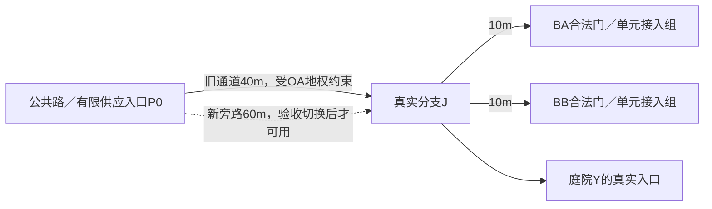

# 两栋不同产权住宅共享庭院、通道与管线的完整案例

设计演算：v0.4.29，2026-10-19。价格、权限、服务／施工能力和数值均为冻结的游戏夹具，不是现实法律／工程建议。验证 [楼体—单元—共享设施契约](building-unit-shared-facility-contract.md)，不将任意共有治理、物业市场或完整工程安全模型视为已实现。

## 1. 物件、产权和比较范围

BA与BB是两栋独立楼体，各4套60 m² NIA住宅，共8套／8家庭／16人；每楼GIA360 m²、套内240，其余为公共／结构。OA初始拥有BA全部4套及其楼体／场地剩余权利，OB拥有BB对应权利；不同产权不合并为一个“小区”。租客A1—A4、B1—B4各有独立身份／钱包，初始租约押金明确为0。

主体S以真实已有权利持有并管理独立设施Y：120 m²庭院（80绿化、40硬质）、40 m长×6 m宽的通道使用范围、共同电水管线。Y按庭院、步行带、维护车行带、管线范围四个共享／功能子区表达；道路D、植物P和管线仍各有真实来源，不是Y名下一份万能容量。通道部分穿过OA场地，S具有初始有效的受限通行／管线使用权；这项权利不能随BA拆除而自动消失。

OA、OB分别有建筑→Y使用关系及真实协议，协议明示住户附属使用、服务／维护、费用、空置／转售／退出、违约与改造；S不是临时生成的业主委员会，也没有权随意取用住户钱。D是已有邻图接收楼的房东，4套空置H、每套最多2人，能够接收随后迁出的四户；不是搬迁时凭空造房。

本例同时跟踪8户、OA、OB、S、电力方EU、供水方WU、维护承包方T、合格维护投入供方X、源端SE／SW、接收方D、搬迁方Z、工程承包方Q及工程投入／处置方QX，**21个账户**。物业持有人不自动变经营者；真实供给／作业方另占原运营来源。未展开这些外部供方的全部业务成本，收到钱不等于其净利润。

期初8户各1000、OA／OB／EU／WU各1000、S自有周转金200，其余账户0，现金合计**12200**。各户至少100留作范围外生活保护，不能拿它担保共享设施；S的200为自己的真实资金，不是居民押金或政府免费兜底。楼体、既有设施／接收房源／有限源供给及已生效权利为声明期初资产，不在窗口重收建设价款；本案例只算列明的租住／公共使用、供应、维护、交易、搬迁和新增工程。

窗口连续：W1=[2031-04-01,05-01)正常30日；W2=[05-01,05-31)空置／转售／欠费30日；W3=[05-31,06-10)拆除工程10日。最后只列一个拆后新条款的30日参考，不再叠加为第四次已发生现金。

## 2. 接入、真实通路与容量

每楼人行口、维护／货运口、电口、水口共4个U；Y亦4个，接收楼D亦4个，初始合计16，均未超过单宿主8。人行与低速维护车行分别走已验证的不同物理带，不把人次与车辆数混用。每U只锚定一个真实节点／边内位置；两条道路接在J的拓扑邻接不是给一个门增发两份开口容量。

各H布局槽映射已验证模板接入组，不穿邻户套内；楼内粗到门时间30秒。旧路P0→J40 m＋入楼10 m，步行速度profile1.25 m/s，至单元总70秒；旁路启用后60＋10 m，总86秒，须更新路径／工时／响应解释，不能保持原70秒或算0距离。货运／维修另按自身模式／profile验证，不以步行可达证明卡车可达。

| 真实资源／类型 | 正常能力与同窗需求 | 唯一来源／不得重复 |
| --- | --- | --- |
| 庭院停留 | 20人；A6＋B8＋维护2＝16人 | 一个X并发组；不是两楼各20，实际在场／返程沿原需求 |
| 共同步行带 | 双向合计120人次/h；A24＋B36＋维护6＝66 | 原双向D及一个共用吞吐约束，不按每方向再发120 |
| 维护车行带 | 双向合计12车次/h，正常4；施工窗含日常需求的联合峰最多6 | 独立模式／几何及吞吐约束，不与人次相加 |
| 共同电馈线 | 负荷端40 kW、源端42；A峰12＋B16＋公共2＝30 | A支路20、B25、公共2也分别检查；损耗边界为交付量附加5% |
| 共同供水 | 负荷端1.5 m³/h、源端1.65；A峰0.4＋B0.6＋公共0.1＝1.1 | A支路0.5、B0.8；附加损耗10%，不是把水源／管线各算一份水 |

上述是冻结游戏曲线／上界，不从日平均推峰值；维护／施工实际到达仍须在模式、合法窗口和容量内。组满／封闭须保留原在途／在场，不能挤掉已存在住户。庭院非公共无限通行，只有已授权住户／访客／作业方可用；欠费协议本例**没有自动撤销既有通行权**或连坐停供条款。

## 3. 真实交付、不同分摊依据和维护

单元编号与家庭编号分属不同命名空间：如“A4单元”与“家庭A4”不是同一主体，出售单元不出售住户或钱包。每个在住A户每日私人电3 kWh、水0.1 m³；B户电4 kWh、水0.15 m³。Y每日实际公共照明2 kWh、绿化等用水0.2 m³；空置A4在本profile断用户负荷后私人消耗明确0，公共负荷不随其空置自动变0。电售0.50／负荷端kWh，EU购源端0.30；水售2／负荷端m³，WU购源端1；没有管存／储能，输入＝终端＋明示损耗。

| 每个正常30日 | 真实费用／交付 | OA负担 | OB负担 |
| --- | ---: | ---: | ---: |
| 庭院维护 | 60 | 20 | 40 |
| 通道维护 | 30 | 10 | 20 |
| 共同管线维护 | 30 | 10 | 20 |
| 公共照明：60 kWh×0.5 | 30 | 7.50（1/4） | 22.50（3/4） |
| 公共用水：6 m³×2 | 12 | 4（1/3） | 8（2/3） |
| **S应收／实际公共成本** | **162** | **51.50** | **110.50** |

维护成本用1/3／2/3，公共电量用1/4／3/4，水用1/3／2/3，均为各自已有合法依据，不因某一比例方便就拿来改物理交付。父表、电水分配、私人量／公共量／损耗不再叠加一次。

A每套租金90＝基础80＋已含维护部分10；B每套90＝基础70＋已含维护20。包含部分同债权人、账期、清偿规则，走原H应计；**不再向租客另收这份维护费**。OA／OB仍按实际协议对S负责，不保证“租户刚好付多少，房东就只负责多少”。公共电水由房东从自身租金／余额支付，不重复加入租客私人电水单。

T按已完成作业向S收120，另为EU／WU各自边界外的供给设施维护收30／15；边界与Y管线维护不同，不能重复同一设备作业。T向X付已交付合格劳务／交通50%和相容材料30%，本期165对应132，剩33只列现金差额。X有有限库存／资格／作业承诺，不以一张发票凭空完成维护。

实际工作profile每30日庭院12h、通道4h、管线4h，外网EU5h／WU3h，共28h；等比例日作业为56分钟，X合格能力全项目合计最多2h每天。按原S03／S04／S10落实资格、材料、到达与交付，回执才改变条件；钱不代替作业。阶段按量实际交付，允许在10日截至时按已完成量结清，不将未完成“整月检查”简单除3冒充完成。

S先以自有200周转付实际维护120和公共电水42，最低38，再收两房东162回到200。T获得已约定的阶段款后按真实输入回执付款；上游能源／X费用在家庭月底回款前也可由既有周转覆盖，不隐借居民未来收入。比例／费率／作业规则未配置时，此夹具不应投运。

## 4. W1：正常30日的完整账

| 量／收支 | W1 |
| --- | ---: |
| 私人电A／B、公共电，kWh | 360／480／60 |
| 总终端电／源端／损耗，kWh | 900／945／45 |
| 私人水A／B、公共水，m³ | 12／18／6 |
| 总终端水／源端／损耗，m³ | 36／39.6／3.6 |
| 各A户租金／私人电水 | 90／51，总141 |
| 各B户租金／私人电水 | 90／69，总159 |
| OA／OB收租 | 360／360 |
| OA／OB付S | 51.50／110.50 |
| EU收私人＋公共电／购电／外网维护 | 450／283.50／30 |
| WU收私人＋公共水／购水／外网维护 | 72／39.60／15 |
| S收／付 | 162／162，净0 |
| T收／付X | 165／132，净33 |

未列的房屋全生命周期／外部供方生产成本不是0，只是不从本例现金差额宣称完整利润。正常窗口已实际交付／付款，租约／能源／维护无逾期；所有者与使用者的余额仍分别保留。

## 5. W2：空置、单元转售、欠费同时发生

### A4空置：固定份额不随分母变小

05-01前A4租约依法结束并结清，搬迁到已声明D1实际完成，BA的A4单元成为空置；家庭A4身份／钱没有删除。A4付D150（首30日租金50＋可退押金100）、付Z真实搬迁50，共200，单独入账。接收房源／人数／路线事先可行，不是原地删人。

W2 A只有3户使用私人资源，A私人电270、水9；B不变，公共电60／水6不变。因此全窗口终端电810、源端850.5，终端水33、源端36.3。OA少收A4租金90，但公共固定51.50仍由OA承担，不能向其余3户把维护10改为13.33，亦不能把公共负荷私自当0。

### 空置A4转售给A1：产权、租约、附属权和旧债分别处理

在05-16（W2第15个完整游戏日后），住户A1用自身现金500向OA全款购买已实际空置、无租约的A4单元，符合首版限定买卖；它继续租住A1单元，原租约与90租金不变。A2／A3亦各90，故OA当期收租270，并收到真实售款500。A1拥有一套空房并租住另一套，是不同产权／居住关系，不新造H、F或入住人口；空房没有暗中出租或再计居住容量。该买卖夹具适用税费／手续费显式0，不表示现实交易免费。

附属庭院、通道和管网使用依据随限定单元权利依法关联；使用边仍是BA→Y，不生成第三栋楼。OA对S的51.50责任按原协议继续，未自动转给A1；A1没有无预算的“物业应计”侧表。OA保留共同部位的管理／付款责任，A1负责自己的单元和已支持设备。空置A4的私人供应绑定付款方按05-16切为A1，明确零负荷、无私人固定费／未结旧账；原家庭A4已在D1，其账不随单元产权转给A1。价格500和相关范围为本次双方明确接受，非自动市场套利收益。

### OB欠费：S已完成维护，不等于所有人已付款

B四户仍各按H租约付90，OB收到360，却在05-31不付S的110.50。S已付162并只收到OA51.50，自有现金从200降到89.50；留下对OB110.50的同一配对应收／应付，原票含80／22.50／8三明细，本例具有相同信用、优先和清偿规则，不重复发三份110.50本金。

庭院／道路／B管线权利仍按原有效依据，不能因OB欠费封B唯一通路、切断另一楼或向OA补收110.50。未来作业还需真实资金：若OB继续不付，S的89.50不足下一完整期162，须依法安排资金／变更新承诺并如实报告维护短缺；不生成补贴、不把应收当钱，也不抹掉已发生债务。

## 6. W1与W2端点现金／义务

| 账户 | 期初 | W1末 | W2末 |
| --- | ---: | ---: | ---: |
| A1 | 1000 | 859 | 218 |
| A2／A3，各 | 1000 | 859 | 718 |
| A4 | 1000 | 859 | 659 |
| B1—B4，各 | 1000 | 841 | 682 |
| OA | 1000 | 1308.50 | 2027 |
| OB | 1000 | 1249.50 | 1609.50 |
| S | 200 | 200 | 89.50 |
| EU | 1000 | 1136.50 | 1256.35 |
| WU | 1000 | 1017.40 | 1032.10 |
| T／X | 0／0 | 33／132 | 66／264 |
| SE／SW | 0／0 | 283.50／39.60 | 538.65／75.90 |
| D／Z | 0／0 | 0／0 | 150／50 |
| Q／QX | 0／0 | 0／0 | 0／0 |
| **合计** | **12200** | **12200** | **12200** |

“各”行须乘真实人数，不能把分组表当一户大钱包。W2末仅列明OB的110.50已到期未清本金；D的100押金仍在150现金内受保护，并保留对A4的返还责任，不是租金收入或第二份余额。各户100生活保护仍在自己的原现金内。现金守恒不把非现金房产和押金义务再加成现金。

## 7. W3：先展示拆除失败，再完成可执行方案

### 未获授权／未替代依赖时，失败且无副作用

OA在05-31提出直接拆BA、封通道、切共管。此时空置A4的产权属于住户A1，A1—A3实际仍在租住，且BB与Y依赖穿OA地权范围的设施，因此工具返回产权／依赖未满足：不拆、不收费、不删除H、使用权／路线／欠款。买回单元也不自动代表人已搬走。

正式方案先核：单元处分与租客程序、真实安置容量／资金、S／OB对替代通路及未来费用的明确同意、旁路几何／路权／容量／作业安全与旧在途退出、原债与未来记录槽。OB如不接受后续条款，方案仍受阻；可继续谈判或保留原走廊及其地权／维护责任，不能单方面给B涨价后强拆。

### 明确现金和迁移前置

1. OB先从真实1609.50中付清旧110.50，S回到200；不是减免，也不是买卖转移给新业主。
2. OA以2027自有现金为计划预留：单元回购550、向A1搬迁补偿50、A2／A3各150，共900；旁路400、拆除／断接／清运600；本窗口公共费上界17.17及临时施工能源12，共需1929.17，未用未来收租／售地担保。
3. OA先向A1实际支付550并取得空置A4的产权及有效处分依据；产权与其零负荷供应付款方切回OA，旧账／证据保留。此回购不等于A1—A3已迁出。另实际支付搬迁补偿50／150／150，三户各付D150与Z50，预约D2／D3／D4并沿真实出行到达。D每套首30日租金50、押金100；D租金包含其自身合法供应，外部输入未展开，不称纯利润。Z最多接收4户搬迁／日，合格运力／道路实际可行；原住户不因给钱瞬移。
4. 06-02边界前，三户已实际退出并到达接收单元，必要租约／处分程序完成；A1／A2／A3原租约实际两日各6结清。A1同时是空置A4的卖方和租住A1的迁出方，两项依据分别验证，仍用原账户，不复制钱包。早期A1现金218＋已完成回购款550＋补偿50−搬迁200＝618，仍≥100生活保护；后付本窗租6／私人电水3.40，期末608.60。回购是先真实完成的独立空房买卖，不能用未来成交款担保搬迁。
5. A4在05-31真实续付D下一30日租金50，已有押金100不再收一遍。至观察窗末D共收650，其中400是四户押金受限、250为已列租住付款；Z共收200，均有原票与责任。

### 旁路、容量、切换与施工进度

旁路位于S已具有合法使用依据的范围，真实长度60 m；庭院和BB支路不迁位，只换P0→J的共同段。新步行／维护车行仍120人次/h／12车次/h，电负荷端30 kW／源端31.5，水负荷端1.2 m³/h／源端1.32。BB原支路25 kW／0.8 m³/h保持；加公共2 kW／0.1及施工2 kW／0.05也≤29 kW／0.95，足以在新共同能力内运行，不从“只剩B”就任意削减其原支路权利。

| 工程 | 实际交付报价／工时 | 真实阶段／释放条件 |
| --- | --- | --- |
| 新旁路及电水支撑 | 400／32合格工时 | 30h施工／验收在前2日，剩2h为投运至06-10的初期巡检；验收前不可用 |
| 断开A用户与安全保全 | 100／8h | 06-02实际迁出、B旁路生效后实施，不切B支路 |
| BA拆除 | 350／40h | 有效程序与安全围护后执行；不能把付款当倒楼 |
| 旧段／废物清运／场地移交 | 150／16h | 出口／运输／有限接收实际完成，最迟06-10收尾 |
| **资本／工程现金** | **1000／96h** | 冻结最低10游戏日，候选16h每日不能压缩安全等待与到期 |

旁路报价400分前2日施工验收380和其后初期巡检完成20；新段投运至06-10的实际保全已含，不再向S重复收同一作业。Q按已验收阶段共收1000，向QX付相容材料60%／合格作业运输检验20%共800，Q余200仅列净现金。QX事前有有限材料／服务／处置承诺；同一16h每日能力串行使用，总工时下界6日但最低日历10日，不能把四阶段并行各用满16h。

06-02在同一游戏时刻封闭旧区间：旁路已验收／当前合法／容量可行，迁入／在途来源与资源引用按规则切换；已在旧走廊者保留原位置／版本并安全退出，不瞬移到新路。旧公共段直到真实在途／占用为0、受支持断接／检验完成才释放。A的施工接入保留到最后一批废物运出，不能居民迁出就删掉全部工地路径。新旧并存按实际占两套记录，满额不得提前释放旧物。

两天前A三户实际私人交付电18 kWh、水0.6 m³；此后A居住负荷明确0。施工临时独立来源另耗20 kWh电、1 m³水（2 kW×10h、0.05 m³/h×20h），OA另付EU10／WU2，不能藏进B的账单或当作空房免费电水。新站／临时绑定／作业窗口需原额度，能源与报价1000分列不双收；水电抽象不宣称算出了真实解压／管内余水。

BA结构按360 m²冻结profile形成120废物单位，退役旧公共段／A支线另12，合132；按30／30／30／30／12五批真实运到QX，QX本次可用接收／有限存量200、每日最多30，最终已接收132、余68、工地0。到期不自动销毁，若车路／接收堵塞保留现场／在途，延期和费用依法更新，不删除旧源。

### 最后才结束使用／条款，拆后费用须另获同意

A的附属使用关系、户籍／住房投影、支线与共有维护责任在实际退出／断接／债务移交后分项结束；物理BA清场、H退役和关系归档是不同事件。楼体旧ID／几何／法令／协议证据仍可追溯，不复用成另一楼。拆除本身不卖出土地，若保留地块／旧使用权则仍有原主体，不把它删除成无主地。

截至06-10旧条款按实际作业封闭：庭院维护4h费用20，旧通道／管线在退出前的保全巡查各80分钟、费用各10，共40；后两项不含Q的断接／新段验收／退役清运，不是旧物删除后仍收费。新段初期巡检另由旁路400报价的2h承担，工单来源与T不重复。加公共电10／水4，共54。OA旧份额为40/3＋2.5＋4/3＝17.166…，按冻结尾差规则付17.17，OB付剩36.83，合54；不是把A欠／退部分无权重摊B。费用区间已经封闭，未交付的未来20日不能按整月162强收。

新条款从06-10前瞻生效，**须S与OB明确接受**：庭院维护60不变，新长通道45、新管线45，共150／30日；公共电30、水12，合192，改由OB按约承担，S仍只提供同一批真实服务。新路线更长，维护不必因少一楼就更便宜；B的租约90没有热改，OB自行吸收由旧110.50到新192的差额81.50，不能直接加到B租客。OB期末已有现金1582.17，可依法预留192，不借未来租金担保。新条款一完整周期S的192收付匹配，周转200最低可到8；若B不付仍有实际资金／维护风险，非永久保底。

## 8. W3十日费用、交付与最终现金

| 运行项目 | 十日实际量／金额 |
| --- | ---: |
| 电终端：A私人18＋B160＋公共20＋施工20，kWh | 218 |
| 电源端／损耗，kWh | 228.9／10.9 |
| EU收入A9＋B80＋公共10＋施工10 | 109 |
| EU购电／自身外网维护 | 68.67／10 |
| 水终端：A0.6＋B6＋公共2＋施工1，m³ | 9.6 |
| 水源端／损耗，m³ | 10.56／0.96 |
| WU收入A1.2＋B12＋公共4＋施工2 | 19.20 |
| WU购水／自身外网维护 | 10.56／5 |
| T收实际维护40＋10＋5，付X | 55／44 |
| S收OA17.17＋OB36.83，付维护40／电水14 | 54／54 |

| 账户 | W3末现金 |
| --- | ---: |
| A1／A2／A3／A4 | 608.60／658.60／658.60／609 |
| B1—B4，各 | 629 |
| OA／OB | 115.83／1582.17 |
| S | 200 |
| EU／WU | 1286.68／1035.74 |
| T／X | 77／308 |
| SE／SW | 607.32／86.46 |
| D／Z | 650／200 |
| Q／QX | 200／800 |
| **全部21账户合计** | **12200** |

原OB逾期110.50已真实付清，工程／本窗口费用已付，未增加透支；D四份可退押金400的返还义务仍分别存在，OB未来192及各户生活100的合法保护不另造现金。非现金方面：BA及4套H退役、BB／其4户保持，接收楼D原4套现住原A四户，F共8个家庭／16人未删除；旁路为新实物，旧段／废物有退役与接收来源，不能用现金表掩盖资产和责任变化。

## 9. 记录、共享边与16 GB预检

持久基础对象BA、BB、Y、既有接收楼D分别有真实身份；Y的庭院／通道／管线子区不把每个使用方再变一份设施；旧4区加旁路步行／车行／管线3区峰7≤8，不能因为新旧并存而免区数。BA／BB各指Y的建筑级使用关系共2条，细范围与合同另引用；不是8户各发整份庭院产权。迁到D的单元附属使用沿D既有规则，不对Y生成新使用方。

| 全过程保守预检 | 原额度内的数量／边界 |
| --- | --- |
| B／H／F／账户 | 至少4持久B；独立施工设施如需要另准入，预检5；H12（原8＋接收4）、F8、账户21 |
| 运营O | EU／WU／T／X／SE／SW／Z／Q／QX等9真实运营来源；OA／OB／S／D不因持资产自动多一家企业，具体profile／资格仍须已支持 |
| 一般C | 预检24，至少19明确持续来源：两房东—S、三份设施／供方维护及T—X共4、两源采购、四户Z搬迁、两租客补偿、A1搬迁补偿、OA—Q、Q—QX、B新协议、旧跨OA地权走廊依据。租约／产权程序另沿H，不拿24代替无限协议 |
| 本地供应绑定／M | 原H12＋Y1＝13，施工临时1峰14；最多电水两资源。源端交换M2，物理／分配与收费边界不重复累计 |
| U | 原4对象各4＝16，现场如需独立3口预检峰19，单宿主仍≤8；旁路改拓扑不复制所有门 |
| 共享关系／X | BA／BB→Y2条（待退出也占位）；庭院并发1、旧步行／车行共同吞吐2，旁路并存再2，X峰5，旧真退出才释放 |
| K／P | 原电／水公共干段独立条件各1，旁路新电／水各1，K峰4；原支路条件不重置，原P绿化1份 |
| 道路／水电D | 旧三段双向步行／维护两模式共12有向记录，新旁路两模式双向再4峰16；水电各原主／A支／B支／公共支4边，旁路各加1峰10；原几何／节点／反查另计真实字节 |
| J／库存／货运／OD／义务 | 旁路与拆除独立J峰2；I预检64、同时货运4、活跃OD预检16（去／在场／返程来源共同计），未清／收尾义务预检64；源实际装不下则缩并发／重预算，不能清事实 |

一般C至少19的清单按真实持续关系而非每期账单计槽；同一共享账单三明细在本例同债权／规则／到期可形成单本金，押金四个不同家庭则保持四来源。新旧条款／网络／设备／在途／地形固定版本与索引都计原预算，保守槽数不保证每项峰值可同时装入字节。

原区域27项43.0078125／44 MiB、余0.9921875 MiB，模拟其他用途314.025 MiB、应用2.65／3／4 GiB目标不变。本例未新增动态表；这些来源占原表份额，不在区域外免费再放一套。没有为每户复制路网／完整组件／压力场或agent，静态布局、分摊与粗时间共享，但资金、产权、余数和旧责任不可平均掉。

静态账本只能证明列明的21账户／阶段／量和算术，不证明原始几何、有限输入／作业profile、所有字段／反查／保存恢复已经实现；真实16 GB性能、同刻切换／满额、故障、未按时搬迁／在途无法退出及完整联合场景仍需原型验收。

## 10. 异常分支与City Team观察回执

上述现金只对应实际完成的主轨迹。下列为替代故障输入／预期规则，不再把未发生的费用加到主账：

| 注入点 | 应停／应继续什么 | 可核的原来源 |
| --- | --- | --- |
| A4未实际腾空或租约未合法结束 | 拒绝空置单元交易，不先过户／注销原租约 | H产权、租约、F实际位置与付款均保持 |
| 转售时发现旧债／未决维护 | 按已确定债务主体保留，合法移交需明确同意和配对依据；否则交易条件未满足 | 不因owner变化清旧账，也不让住户A1承担OB欠款 |
| OB继续欠110.50 | 原账不清；新作业先检查S真实资金和允许的承诺，报告缺口／按程序处理 | S89.50、OB债务110.50，不能拿应收当现金或连坐断B唯一通路 |
| A1拒绝卖回A4或三户未实际搬离 | 不推进依赖这些条件的拆除；不取消仍有效租约／居住事实 | 产权与居住两个前置分别返回未满足；已经完成的交易不自动反向撤销 |
| OB／S不接受旁路或192新条款 | 本拆除方案仍受阻，保留旧权利／现有效条款，需重新提案 | 不能让另楼被迫补足全部费用 |
| 旁路验收失败／容量不足 | 不切旧路；已交付工程／实际成本和后续停工责任仍保留 | 旧通行／供应继续按实际条件，新未投运能力为0 |
| 旧在途未退出／清运接收满 | 旧资源／现场占用继续计数，延长工期并依法更新费用与资金 | 不是到06-10就自动清0；主账日期不套给失败轨迹 |
| 记录／正文／索引额度不足 | 新承诺不提交；既有产权、欠款、占用和到期仍处理 | 新旧并存峰与收尾槽一并预检，不先删旧以空出配额 |
| 保存恢复／邻图未打开 | 同一时钟、同一主体和已提交区间恢复，继续原到期／有限接收 | 不复制12200、不重复清欠／回购／押金／工单；D原容量不能再售第二次 |

City Team在W1、W2、产权回购、实际搬迁、旁路验收／切换、旧流退出及最终清场边界分别观察：实体／产权版本、家庭实际接入与接收占位、各类型真实能力与实际交付、现金／到期债务／押金、维护回执／未完成量、在途／废物及原配额高水位。命令接受、法定批准、预留资金、支付、工程交付和结果观察各有状态；任何一步成功都不替代下一步。失败返回受影响来源、尚缺条件和已发生事实，不能让agent凭一条“拆除成功”解释全链路。
